<picture>
  <source media="(max-width: 600px) and (prefers-color-scheme: dark)" srcset="assets/profile-window-mobile-dark.svg" />
  <source media="(max-width: 600px) and (prefers-color-scheme: light)" srcset="assets/profile-window-mobile-light.svg" />
  <source media="(prefers-color-scheme: dark)" srcset="assets/profile-window-dark.svg" />
  <source media="(prefers-color-scheme: light)" srcset="assets/profile-window-light.svg" />
  
</picture>

<p align="center">
  <a href="#overview"><picture><source media="(prefers-color-scheme: dark)" srcset="assets/tab-overview-dark.svg" /></picture></a>
  <a href="#stack"><picture><source media="(prefers-color-scheme: dark)" srcset="assets/tab-stack-dark.svg" /></picture></a>
  <a href="#what-im-working-on"><picture><source media="(prefers-color-scheme: dark)" srcset="assets/tab-parallel-dark.svg" /></picture></a>
  <a href="https://docs.parallel.rocks/"><picture><source media="(prefers-color-scheme: dark)" srcset="assets/tab-docs-dark.svg" /></picture></a>
</p>

## Overview

I specialise in **Web3 development**, with a focus on **crypto platforms, and financial interfaces**. My interests include **UI/UX and the architecture of financial systems**.

I'm currently focused on **Parallel**, with an interest in interfaces that bring multiple tools into one interface.

I bootstrap most of my startups and projects, starting small and building them up as I go.

**I'm not looking for work.**

<details>
<summary><strong>Open <code>profile.config.json</code></strong></summary>

```json
{
  "handle": "dipsy778",
  "focus": ["Web3", "UI/UX", "financial systems"],
  "building": "Parallel",
  "bootstraps": "most startups and projects",
  "looking_for_work": false
}
```

</details>

## Stack

Skills that I use in my tech stack across my projects.

<details open>
<summary><strong>Languages</strong> &nbsp; <code>languages.json</code></summary>

<p>
  
  
  
  
  
  
  
</p>

</details>

<details open>
<summary><strong>Frameworks & Runtimes</strong> &nbsp; <code>runtime.config</code></summary>

[](https://skillicons.dev)

</details>

<details open>
<summary><strong>Tools & Platforms</strong> &nbsp; <code>workspace.config</code></summary>

[](https://skillicons.dev)

</details>

## What I'm Working On

[](https://parallel.rocks)

**[parallel.rocks](https://parallel.rocks) · [Parallel Docs](https://docs.parallel.rocks/)**

A trading platform focused on the **Sui ecosystem**. I'm bringing wallet management, trading, and portfolio features together, with a focus on a polished experience across desktop and mobile.

